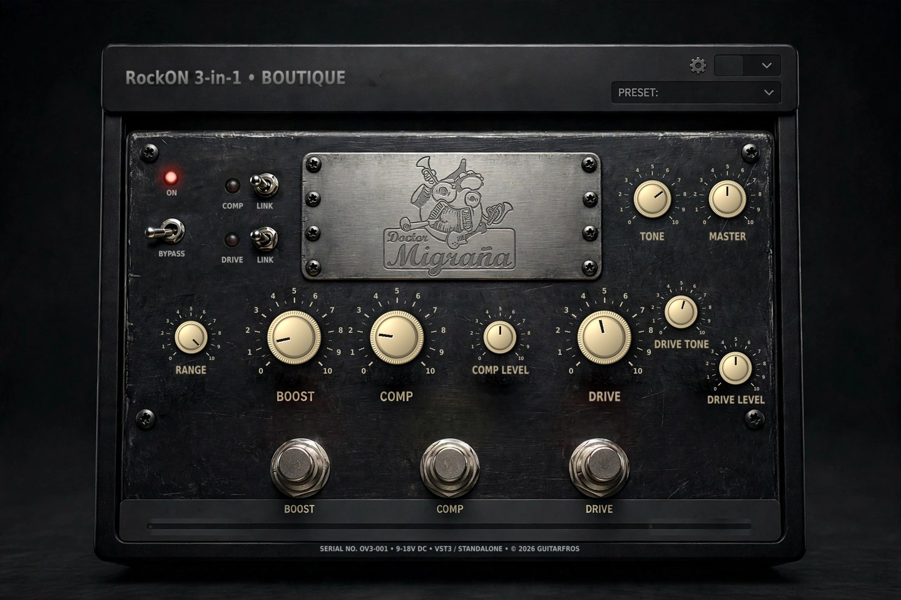

# Doctor Migrana – RockON 3-in-1

A guitar-pedal-style audio plugin (**VST3** and **standalone**) that puts three classic pedal flavours in one box:
**booster → compressor → overdrive**, followed by a global tone control and a master volume.

By **GuitarFros**. Targets Linux, Windows and macOS.


*Mock-up render of the interface (the pointers are drawn at example positions).*

> **Status:** developed and tested on Ubuntu with Reaper. The Windows and macOS builds are produced by GitHub Actions
> and have **not been tested on real machines yet** – feedback and bug reports are welcome.

## What it does

Signal chain: **Boost → Compressor → Drive → Tone → Master**. Each pedal has its own footswitch with an LED.

| Pedal | Controls | Inspired by |
|---|---|---|
| **BOOST** | BOOST (0–24 dB), RANGE (treble booster ↔ full-range boost) | Dallas Rangemaster-style booster, with gentle germanium-like clipping when pushed |
| **COMP** | COMP (sensitivity, up to 36 dB of gain), COMP LEVEL (±12 dB output), COMP LINK | MXR Dyna Comp-style OTA compressor (fast attack "snap", slow release) |
| **DRIVE** | DRIVE, DRIVE TONE, DRIVE LEVEL (±12 dB), DRIVE LINK | Tube Screamer-style overdrive (720 Hz input high-pass, diode clipping, active tone circuit); clean at DRIVE 0, with a progressive gain law up to +41 dB |

Global controls:

- **TONE** – 0 to 10. Position 7 is neutral; above 7 adds extra treble (up to +9 dB shelf).
- **MASTER** – centre (12 o'clock) is 0 dB; from −24 dB to +12 dB.
- **COMP LINK / DRIVE LINK** – when on, turning COMP (or DRIVE) moves its LEVEL knob the other way so the output loudness stays roughly constant, and vice-versa.
- **ON / BYPASS** switch, **A/B** comparison (with *copy A→B / B→A*), and a **preset** menu (4 factory presets + your own).
- **Oversampling** (Off / 2x / 4x) for the Drive stage – gear icon menu (the menu also has *About / Credits*). It adds a small, reported latency.
- Input and output LED meters.

User presets are saved as small `.dmpreset` files in `DoctorMigrana/Presets` inside the user application-data folder
(`~/.config` on Linux, `%APPDATA%` on Windows, `~/Library` on macOS).

## Install

Download the zip for your system from the **Releases** page (or from the *Actions* artifacts) and copy:

| System | Copy the `doctormigranaRockOn3-1.vst3` folder to | Then |
|---|---|---|
| Linux | `~/.vst3/` | Re-scan plugins in your DAW |
| Windows | `C:\Program Files\Common Files\VST3\` | Re-scan plugins in your DAW |
| macOS | `~/Library/Audio/Plug-Ins/VST3/` | Re-scan plugins in your DAW |

The file is called `doctormigranaRockOn3-1.vst3`, but your DAW lists it as **Doctor Migrana – RockON 3-in-1** (by *GuitarFros*).

The builds are **not code-signed**:
- **macOS:** remove the quarantine flag first: `xattr -cr "~/Library/Audio/Plug-Ins/VST3/doctormigranaRockOn3-1.vst3"`
- **Windows:** SmartScreen may warn: *More info → Run anyway* (mainly for the standalone `.exe`).

The standalone application starts with audio input muted (JUCE default): open **Options → Audio/MIDI Settings**,
choose your interface and unmute the input. Use headphones to avoid feedback.

## Build from source

Requirements: CMake ≥ 3.22, a C++17 compiler and internet access (JUCE 8.0.6 is downloaded by CMake the first time).

**Ubuntu / Debian**
```bash
sudo apt install build-essential cmake git pkg-config libasound2-dev libjack-jackd2-dev libfreetype-dev \
  libfontconfig1-dev libx11-dev libxcomposite-dev libxcursor-dev libxext-dev libxinerama-dev libxrandr-dev \
  libxrender-dev libglu1-mesa-dev mesa-common-dev
cmake -B build -DCMAKE_BUILD_TYPE=Release
cmake --build build --parallel $(nproc)
```
The VST3 is copied to `~/.vst3/` automatically (disable with `-DDM_COPY_AFTER_BUILD=OFF`). Build products are in
`build/DoctorMigrana_artefacts/Release/{VST3,Standalone}`.

**Windows** (Visual Studio 2022 with the *Desktop development with C++* workload)
```bat
cmake -B build
cmake --build build --config Release
```

**macOS** (Xcode command line tools)
```bash
cmake -B build -DCMAKE_BUILD_TYPE=Release -DCMAKE_OSX_ARCHITECTURES="arm64;x86_64" -DCMAKE_OSX_DEPLOYMENT_TARGET=11.0
cmake --build build --parallel
```

If you rename or move the project folder, delete `build/` and configure again (CMake stores absolute paths).

## Repository layout

```
Source/        plugin code (processor = DSP, editor = GUI)
assets/        GUI background and small sprites embedded in the plugin
art_source/    the original Meta AI image the background was made from
tools/         scripts that regenerate assets/ from art_source/ (knob rendering, text, clean-up)
docs/          preview image
.github/       GitHub Actions: builds Linux/Windows/macOS and publishes releases for tags "v*"
```

## Credits

- **GUI artwork: the images were created with Meta AI**, except the **Doctor Migraña logo**, which is *not* AI-generated and is the property of **GuitarFros** (all rights reserved).
  The images were edited and composited by GuitarFros with the scripts in `tools/`; the knob caps are rendered by code
  (`tools/knob_render.py`). See [CREDITS.md](CREDITS.md) and [LICENSE-ARTWORK.md](LICENSE-ARTWORK.md) for details and for the terms that apply to the artwork.
- Built with [JUCE](https://juce.com) (AGPLv3). The VST3 interface is the Steinberg VST3 SDK bundled with JUCE.
- Circuit behaviour modelled after the public analyses by ElectroSmash:
  [Tube Screamer](https://electrosmash.com/tube-screamer-analysis),
  [MXR Dyna Comp](https://electrosmash.com/mxr-dyna-comp-analysis) and
  [Dallas Rangemaster](https://electrosmash.com/dallas-rangemaster).

## License

The **source code** is licensed under the **GNU Affero General Public License v3.0 or later** (see `LICENSE`),
which is the open-source licence JUCE 8 requires for open-source projects.

The **artwork** (`assets/`, `art_source/`, `docs/preview.jpg`) is **not** covered by the code licence. It is under
[LICENSE-ARTWORK.md](LICENSE-ARTWORK.md): the images were **created with Meta AI** and are distributed here **for non-commercial,
open-source use with credit to Meta AI**; the Doctor Migraña logo is the property of GuitarFros (all rights reserved).
To use a build commercially, replace the artwork.
See [LICENSE-ARTWORK.md](LICENSE-ARTWORK.md) and [CREDITS.md](CREDITS.md).

## Trademarks and disclaimer

VST is a registered trademark of Steinberg Media Technologies GmbH. Tube Screamer, MXR, Dyna Comp, Rangemaster and
any other product names mentioned are trademarks of their respective owners. This project is an independent work
*inspired by* the sound of those circuits; it is **not affiliated with, endorsed by or sponsored by** any of them.
The software is provided "as is", without warranty of any kind.
